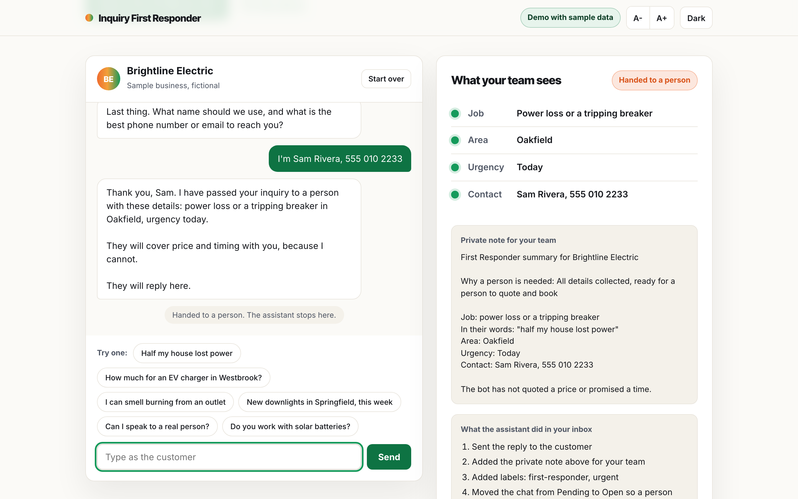
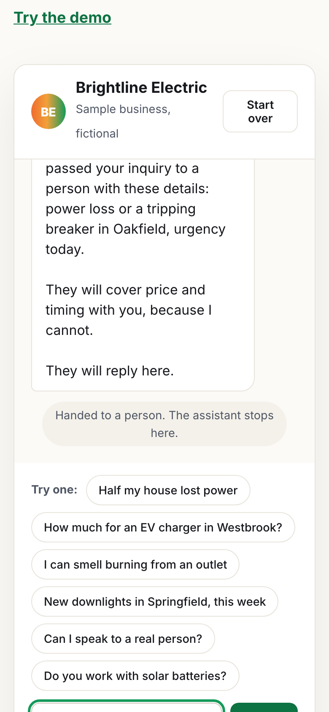
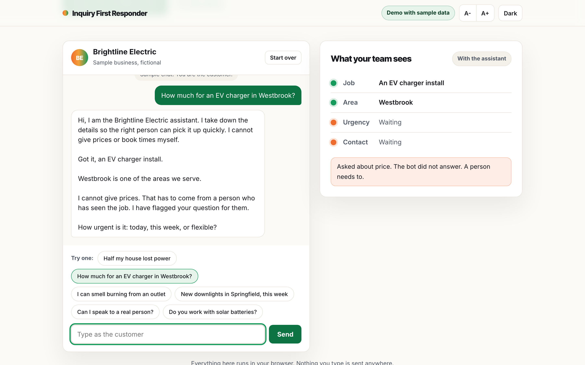
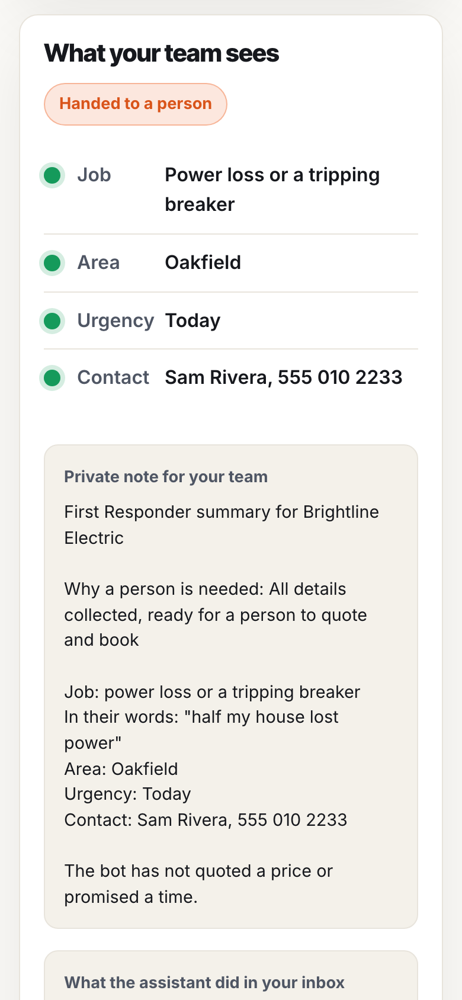
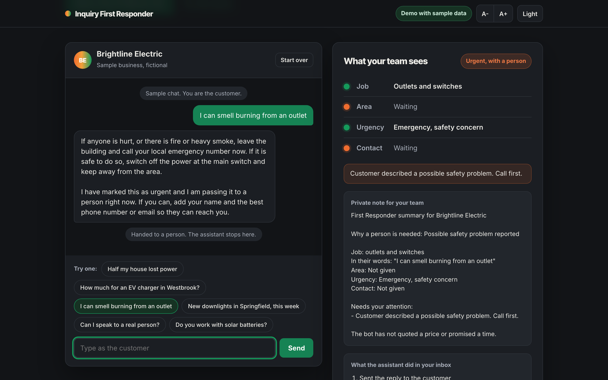
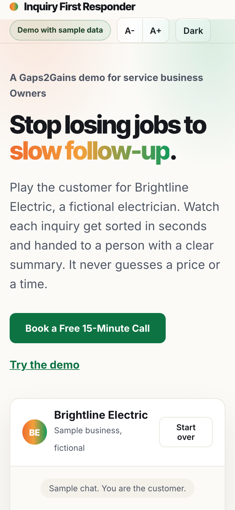

# Inquiry First Responder

**Demo with sample data.** A small TypeScript bot service for [Chatwoot](https://github.com/chatwoot/chatwoot) that answers new inquiries in seconds, collects what a person needs (job, area, urgency, contact), and hands the chat to a human with a short private summary. It never invents a price or a time.

Made by Gaps2Gains for service business Owners who lose customers to slow follow-up on calls and messages. Want to see where your own inquiries leak? Book a [Free 15-Minute Call](https://gaps2gains.com/diagnosis).

Not affiliated with Chatwoot. No Chatwoot code or logo is copied here. Nothing from its `enterprise/` folder was read or used.

## Screenshots

| Desktop | Mobile |
| --- | --- |
|  |  |
|  |  |
|  |  |

Full page: [docs/screenshots/desktop-full-page.png](docs/screenshots/desktop-full-page.png)

## What it does

1. Chatwoot sends a signed webhook to this service when a customer writes in.
2. The service checks the signature, then only acts on a new, public, incoming message in a conversation that is still **pending** (the bot's queue).
3. A rule-based engine reads the message, fills in job, area, urgency and contact, and asks for the next missing piece.
4. When it has everything, or the moment it should not carry on, it replies, posts a private note, adds labels, and moves the conversation to **open** so a person sees it.

It hands off straight away when the customer:

- describes a possible safety problem (the reply gives safety advice first and marks it urgent),
- asks for a person,
- complains or mentions an existing job,
- asks something the bot has no answer for,
- or sends two messages in a row it cannot read.

Price and timing questions are never answered. The bot says so, flags the question in the private note, and carries on collecting details.

### Reply engine

The default engine is plain rules (`src/engine`). It needs no API key and no network. The same code runs in the browser demo.

Optional: set `FIRST_RESPONDER_DRAFTER=claude` and `ANTHROPIC_API_KEY` to let Claude reword routine questions. The rules still decide what is asked and when to hand off. Safety text, hand off messages and anything about price or timing are never sent to Claude. Every draft is checked (no money, times, promises or links, including ones written in words like "fifty dollars" or "within an hour"; few new words; question kept) and the plain wording is used if a draft fails or the call errors. The check is strict, so some good rewordings fall back to the plain text. See `src/server/drafter.ts`.

## What is upstream and what is new

**Upstream (Chatwoot, MIT outside `enterprise/`):** the Agent Bot webhook and API contract this service plugs into. I read these files from the public repo to match the real shapes:

- `app/listeners/agent_bot_listener.rb` (which events reach a bot, and that bots only get `message_created` for `webhook_sendable?` messages)
- `lib/webhooks/trigger.rb` (headers `X-Chatwoot-Timestamp`, `X-Chatwoot-Signature: sha256=HMAC_SHA256(secret, "<timestamp>.<body>")`, `X-Chatwoot-Delivery`, retries on 429 and 500, 5 second timeout)
- `app/models/message.rb`, `app/presenters/conversations/event_data_presenter.rb`, `contact.rb`, `inbox.rb`, `account.rb` (payload fields)
- `swagger/` (send message, toggle status, add labels; agent bot token auth)

Chatwoot's Captain AI is a paid feature. This project replaces it with a small bot of its own through the core Agent Bot webhook, so none of it is used.

**New (this repo, MIT):** everything in `src/`, `demo/`, `test/` and `scripts/`. The engine, the webhook handler, signature checking, the optional Claude drafter, the static demo, and the tests.

## Run it

Needs Node 20 or newer.

```bash
npm install --ignore-scripts
npm test              # unit and integration tests
npm run build         # type check, compile the service, build the static demo
npm run demo          # serves dist/demo at http://127.0.0.1:4173
```

The demo is plain static files in `dist/demo`. Open `index.html` or host the folder anywhere.

### Run the service

```bash
cp .env.example .env   # fill in your own values
npm run dev            # or: npm run build && npm start
```

With no `CHATWOOT_BASE_URL` and `CHATWOOT_BOT_TOKEN` it runs as a dry run and prints what it would send. In Chatwoot, create an Agent Bot whose outgoing URL is `https://your-host/webhook`, attach it to an inbox, and copy the bot's access token and webhook secret into `.env`. New conversations on that inbox start as pending, which is what the bot handles. The service refuses to start without a webhook secret unless `ALLOW_UNSIGNED=true` is set.

Business wording (name, services, areas) lives in `src/engine/config.ts`. It holds fictional sample data.

## Tests

`npm test` runs 91 tests: the engine (qualification, price and availability never answered, emergencies, handoffs), signature checking and replay protection, the handler (which events are ignored, a message that races a handoff, ordering of API calls, failure behaviour), the drafter guardrails, and an HTTP test where the real service talks to a stand in Chatwoot API. Webhook payloads are shaped after Chatwoot's source (`test/fixtures/payloads.ts`).

## Status

Honest summary of what was checked on 2026-11-06:

- **Tested:** unit and local integration tests pass (91). The type check and build pass. The demo page was run in Chromium with Playwright at desktop (1440 wide) and mobile (390 wide) sizes, light and dark, with no console errors and no horizontal scroll. Screenshots above come from that run.
- **Not tested: a live Chatwoot server.** I did not run Chatwoot, create an Agent Bot, or receive a real webhook. Payload shapes, headers and API paths come from reading Chatwoot's public source and API definitions, and the tests use a stand in server. Real world differences are possible.
- **Not tested: the Claude drafter against the live API.** Its tests use a mocked response. No API key was used.
- **Safety words are broad on purpose.** Burning, heat beside an outlet or panel, sparks, flames, arcing, shocks, tingles, buzzing, humming and any smell go straight to a person with safety advice. This means some false alarms. It is still a keyword list, not a guarantee: the bot cannot judge danger, and anything it misses is only caught when the customer asks for a person or the chat stalls.
- **Fixed after an internal audit on 2026-11-06:** messages that race a handoff no longer get a bot reply, replay protection now uses the signed message id, handoff labels are added to a person's labels instead of replacing them, a failed handoff keeps retrying to open the chat, and repeating or stalled chats now hand off.
- **Known limits:** if the process stops in the middle of a job, nothing remembers that the chat still needs a person (no stored retry list). Handoff labels use a read then write, so a label added by a person in the same instant could still be lost.
- **Other known limits:** conversation state is in memory, so a restart makes the bot start the questions again. The rule engine is English only and keyword based, so unusual phrasing leads to a handoff, which is the safe outcome. Attachments are noted but not read. The bot does not set a conversation to pending itself, it relies on the inbox being set up that way.
- Everything about Brightline Electric is fictional sample data.

## License

MIT, see `LICENSE`. Chatwoot is a trademark of its owners, used here only to describe compatibility.
